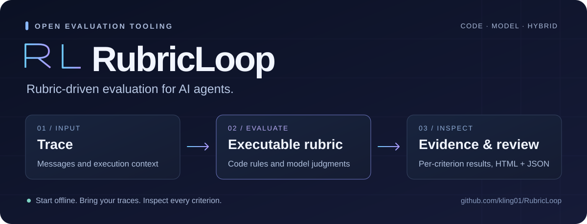
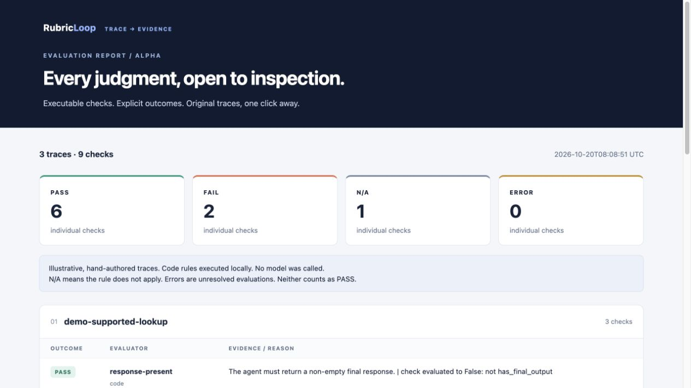

<p align="center">
  
</p>

<p align="center">
  <a href="https://kling01.github.io/RubricLoop/demo.html">在线演示</a> ·
  <a href="#快速开始">快速开始</a> ·
  <a href="docs/usage.md">使用文档</a> ·
  <a href="docs/roadmap.md">开发路线</a> ·
  <a href="https://github.com/kling01/human-value-allocation">Human Value Allocation</a> ·
  <a href="README.md">English</a>
</p>

<p align="center">
  
  
  <a href="LICENSE"></a>
  
</p>

**用可执行 Rubric 评测 AI Agent。** RubricLoop 将执行轨迹转化为可复核的结果：定义评测标准，组合代码规则与模型评估器，在一个独立 HTML 报告中查看每项判断及对应轨迹。

RubricLoop 是**「人在回路」**旗下的开源评测项目。我们从数据质量治理中的具体问题出发：**哪段行为需要关注，哪条标准发现了问题，哪些结果需要人来复核？**

## 当前可以使用的能力

| 能力 | 提供什么 |
| --- | --- |
| **轨迹评测** | 接收简单消息历史，或已经清洗的轨迹树。 |
| **可执行 Rubric** | 在 YAML 中定义确定性规则，按整条轨迹或特定工具设置适用范围。 |
| **模型评估器** | 通过兼容 OpenAI Chat 接口的模型服务执行语义评测。 |
| **混合评测** | 将代码规则结果作为上下文，交给模型进一步判断。 |
| **标准版本化** | 引擎支持带条款 ID 和版本的结构化评估器定义。 |
| **结果复核** | 在 HTML 中查看轨迹、规则结果与模型判断，通过 JSON 接入后续分析。 |

离线演示包含三条人工编写的小型示例轨迹，并实际执行代码规则。它用于检查安装和体验流程，不代表评估器准确率或 benchmark 成绩。

<p align="center">
  
</p>

*上图来自 `rubricloop demo` 的实际运行：3 条轨迹、9 项检查、6 项通过、2 项不通过、1 项不适用。[打开在线报告](https://kling01.github.io/RubricLoop/demo.html)，或运行下方命令在本地打开报告。*

## 快速开始

需要 Python 3.10 或更新版本。

```bash
git clone https://github.com/kling01/RubricLoop.git
cd RubricLoop
python -m venv .venv
source .venv/bin/activate
pip install -e .

rubricloop demo --out runs/demo
```

在浏览器中打开 `runs/demo/report.html`。同一次运行也会生成 `runs/demo/results.json`。

项目从 v0.1.0a2 起由 AgentEval 更名为 RubricLoop。旧的 `agenteval` 命令与 `AGENTEVAL_*` 环境变量继续兼容，Python 导入仍使用 `agenteval`。详见[迁移说明](docs/usage.md#migration-from-agenteval)。

### 评测自己的轨迹

```bash
rubricloop run examples/traces.json \
  --rules examples/rules.yaml \
  --out runs/rules
```

最简单的输入是一个对话 JSON 数组：

```json
[
  {
    "id": "example-001",
    "messages": [
      {"role": "user", "content": "17 加 25 等于多少？"},
      {"role": "assistant", "content": "42"}
    ]
  }
]
```

可以精确表达的标准交给代码规则；需要语义判断的标准可以增加模型评估器：

```bash
export RUBRICLOOP_BASE_URL="https://your-provider.example/v1"
export RUBRICLOOP_MODEL="your-model"
export RUBRICLOOP_API_KEY="your-api-key"

rubricloop run examples/traces.json \
  --rules examples/rules.yaml \
  --evaluators examples/judge.yaml \
  --concurrency 4 \
  --n-runs 1 \
  --out runs/judged
```

模型服务会收到评估器提示词选取的轨迹内容，这个命令可能产生 API 费用。离线演示无需模型服务或 API 密钥。

输入格式、规则语义、模型配置与结果说明见[使用文档](docs/usage.md)。

## 工作流程

```text
轨迹 / 消息历史
      │
      ▼
标准化与特征提取
      │
      ├── 代码规则 ──────────┐
      │                     │
      └── 模型 / 混合评估器 ─┤
                            ▼
                     HTML + JSON 结果
                            │
                            ▼
                        证据与复核
```

每项标准保留独立结果：

| 值 | 含义 |
| --- | --- |
| `1` | 通过 |
| `0` | 不适用 |
| `-1` | 不通过 |
| `null` | 评测出错，需要查看原因与配置 |

**代码规则的 `check` 表达的是违规条件：** 返回 `True` 时判为不通过。规则在本机执行 Python 表达式，不是沙箱；请使用自己信任、检查过的规则文件。

报告分别统计通过、不通过、不适用与出错的数量。模型评估器的判断需要通过人工复核样本校准。

## 当前版本范围

当前版本包含评测引擎、命令行入口、人工编写的示例与独立报告。引擎具备结构化 Rubric 条款与版本能力，公开 CLI 首先支持整条轨迹的评测。

后续将推进评估器反馈与修订、回归检查，以及数据生产工作流集成。政策文档到 Rubric 的生成、自动修复闭环、模型训练、人类介入价值预测，均列入[开发路线](docs/roadmap.md)。

## 关联研究与工具

[**Human Value Allocation**](https://github.com/kling01/human-value-allocation) 是独立项目，用于分析人机对话中可观察的人类贡献。

其关联论文 [*From Tasks to Turns: Measuring Human Labor Contributions in Human–Agent Joint Production*](https://arxiv.org/abs/2610.26365) 为人类参与研究提供基础。RubricLoop 提供通用评测组件，本仓库不声称已复现该论文的实验。

## 参与贡献

欢迎提供具体评测案例：最小轨迹、希望检查的标准、实际结果和预期结果。提交 [Issue](https://github.com/kling01/RubricLoop/issues) 前，请移除私有数据和凭据。

可运行的接口见[使用文档](docs/usage.md)，当前能力范围和后续方向见[开发路线](docs/roadmap.md)。

## 开源协议

[MIT](LICENSE)。
